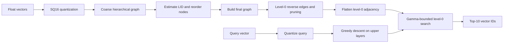

# 方法与实现

我以 HNSW 为基础，主要从构建顺序、底层图结构和查询扩展三个方面做调整，再结合量化、SIMD 和访存优化降低执行开销。

## 构建与查询流程



## 两遍建图与 LID 顺序

不同区域的检索难度不同，我希望优先插入局部结构较复杂的点，让这些点更早参与图的构建。为此，我使用局部内禀维度（LID）作为难度指标，并设计了两遍建图流程。

第一遍，我先按向量第 0 维排序，以较小的搜索宽度建立粗图。然后从每个节点的第 0 层邻接表中取至多 `K_LID_` 个邻居，计算并排序距离，用对数距离比估计 LID。

第二遍，我按 LID 降序重新排列节点，恢复正式构建参数，再建立最终图。粗图只用于估计插入顺序。

## 第 0 层图后处理

建图完成后，我遍历第 0 层已有的边，为缺少反向连接的节点补边。邻接表超过 `M0_` 时，再根据距离和邻居多样性进行剪枝，同时去掉自环及重复 ID。

这一步的目的是补充局部连接，同时控制节点度数和搜索时需要访问的邻居数量。

## 查询扩展控制

查询时，我先从高层入口贪心下降，再在底层维护候选最小堆和结果最大堆。为了控制尾部扩展，我根据结果堆中当前最差距离 `d_k` 设置阈值：

```text
bound = (1 + gamma) * d_k
```

当弹出的候选距离超过这个阈值时，我停止扩展；新发现的邻居也只有在距离不超过阈值时才加入候选队列。结果堆保留当前最优的 `efS_` 个候选，最后返回前 10 个 ID。

`gamma` 决定搜索余量：较大的值允许更多扩展，较小的值更早收紧搜索范围。我通过调参比较它对召回率和查询时延的影响。

## 实现层优化

| 技术 | 我的做法 |
| --- | --- |
| SQ16 | 使用全局最小、最大值计算缩放，将 float 坐标量化为 int16，维度补齐到 16 的倍数 |
| AVX2 | 用 AVX2 指令计算量化向量间的距离，并保留标量距离分支 |
| 扁平化邻接表 | 第 0 层使用固定 stride 的 `[degree, neighbors...]` 布局 |
| 预取 | 遍历邻居时预取下一邻居的向量数据 |
| 并行构建 | 根据硬件并发数创建线程，使用节点锁和线程本地 visited 状态 |
| visited 版本号 | 用递增 token 标记访问，避免每次查询清空整张标记数组 |
| 距离计数 | 提供计数器开关，统计构建或查询中的距离计算次数 |

## 参数设置

最终提交中，我使用以下参数：

| 参数 | 值 | 含义 |
| --- | ---: | --- |
| `M_` | 16 | 上层最大度数 |
| `M0_` | 54 | 第 0 层最大度数 |
| `efC_` | 500 | 正式建图搜索宽度 |
| `efS_` | 10 | 查询结果候选宽度 |
| `gamma_` | 0.21 | 查询距离阈值余量 |
| `enable_lid_preprocess_` | true | 启用 LID 两遍建图 |
| `EF_LID_BUILD_` | 64 | 粗建图搜索宽度 |
| `K_LID_` | 32 | LID 估计的邻居数量上限 |

调参时，我考察了 `M0 ∈ {50,52,54,56,58,60}`、`efConstruction ∈ {300,400,500}` 和 `gamma ∈ {0.17,0.18,0.19,0.20,0.21,0.22}`，结合召回率、查询时延、距离计算次数和构建时间选择最终配置。
