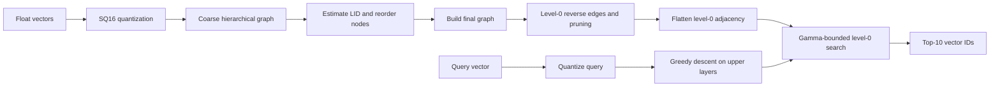

# 方法与实现说明

本页根据最终提交源码和 2026 年 1 月 11 日的报告整理。源码保持原样；这里描述实现流程，不增加新的实验结论。

## 构建与查询流程



### 两遍建图与 LID 顺序

先按向量第 0 维排序，并使用较小的构建搜索宽度建立粗图。对每个节点，从第 0 层邻接表取至多 `K_LID_` 个邻居，计算和排序距离，以对数距离比形式估计局部内禀维度（LID）。随后按该估计值降序排列节点，恢复正式参数，重新建图。

这是基于粗图邻居的难度估计：代码取的是邻接表中的一批邻居，不是额外执行精确 kNN。并行线程从排序后的工作队列取点，实际完成插入的先后还受到线程调度影响。

### 第 0 层图后处理

遍历已有边，尝试补入缺少的反向边。对超过 `M0_` 的邻接表，用基于距离和邻居多样性的启发式筛选控制度数，并过滤自环及重复 ID。由于后续剪枝仍可能移除边，这个过程不保证最终所有边都严格双向。

### 查询扩展控制

从高层入口执行贪心导航，再在底层维护候选最小堆和结果最大堆。以结果堆中当前最差距离 `d_k` 构造阈值：

```text
bound = (1 + gamma) * d_k
```

当弹出的候选距离超过该阈值时停止扩展；新发现的邻居只有在距离不超过阈值时才进入候选队列。结果堆独立保留当前最优的 `efS_` 个候选，最终返回前 10 个 ID。这里的“候选约束”指距离阈值约束，并非候选堆具有固定容量上限。

### 实现层优化

| 技术 | 源码中的做法 |
| --- | --- |
| SQ16 | 使用全局最小、最大值计算缩放，将 float 坐标量化为 int16，维度补齐到 16 的倍数 |
| AVX2 | 编译时定义 `__AVX2__` 后启用向量化距离分支，否则选择标量距离分支 |
| 扁平化邻接表 | 第 0 层使用固定 stride 的 `[degree, neighbors...]` 布局 |
| 预取 | 遍历邻居时预取下一邻居的向量数据 |
| 并行构建 | 根据硬件并发数创建线程，使用节点锁和线程本地 visited 状态 |
| visited 版本号 | 用递增 token 标记访问，避免每次查询清空整张标记数组 |
| 距离计数 | 可通过静态接口启停和读取距离计算计数器 |

## 最终源码中的参数

| 参数 | 值 | 含义 |
| --- | ---: | --- |
| `M_` | 16 | 上层最大度数 |
| `M0_` | 54 | 第 0 层最大度数 |
| `efC_` | 500 | 正式建图搜索宽度 |
| `efS_` | 10 | 查询结果候选宽度 |
| `gamma_` | 0.21 | 查询距离阈值余量 |
| `enable_lid_preprocess_` | true | 启用 LID 两遍建图 |
| `EF_LID_BUILD_` | 64 | 粗建图搜索宽度 |
| `K_LID_` | 32 | LID 估计的邻居数量上限 |

`enable_lid_preprocess_` 旁的原注释写有“默认关闭”，但实际初始化值是 `true`；本说明以实际赋值为准，原注释未改动。

报告描述的参数搜索空间为 `M0 ∈ {50,52,54,56,58,60}`、`efConstruction ∈ {300,400,500}` 和 `gamma ∈ {0.17,0.18,0.19,0.20,0.21,0.22}`。仓库仅保留报告中的描述和截图，不将其扩写为新的运行记录。
